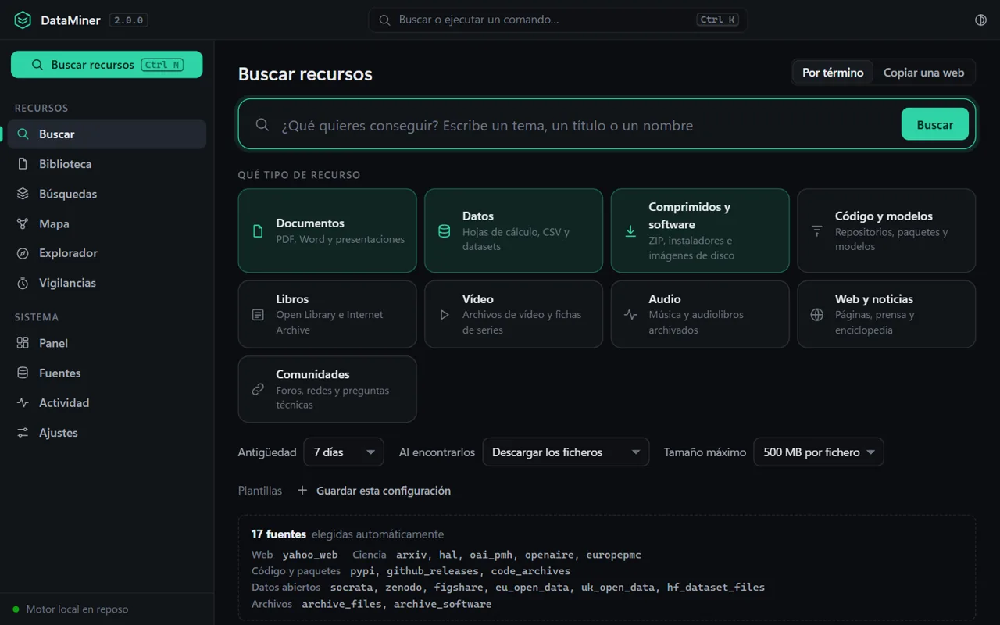

<p align="center"><a href="README.md">Español</a> · <b>English</b></p>

# 🕷 DataMiner: one spider per search criterion



Give it a term and DataMiner searches for it across **20 sources** at once (web search engines, world press, social networks, forums, code, science and archives). It keeps only what is **recent** (the last 7 days by default). It then visits each result, extracts the clean content as Markdown, follows the relevant links and downloads the linked files (pdf, csv, xlsx…). Everything is saved in `output/`.

## Download (Windows)

1. Go to the [Releases](https://github.com/virtuanista/data-miner/releases/latest) page and download `DataMiner-2.0.0-windows.zip`.
2. Unzip it into any folder and open **`DataMiner.exe`**. It does not need Python.
3. Your searches and downloads are saved in `%USERPROFILE%\DataMiner\output\`.

Requirements: Windows 10/11 with WebView2 (already installed on almost every computer).

## Desktop app (recommended)

Double-click **`DataMiner.bat`**: it opens in its own borderless window. If you prefer the browser, use `dm web`. If port 8787 is taken by another version, it uses the next free one.

Sections:

- **Buscar** (Search): one field plus the resource type (documents, data, archives and software, code, books, video, audio, web and news, communities). The sources and the `filetype:` operators are chosen automatically according to the type. «Afinar la búsqueda» (Refine the search) expands the operators (exact phrase, `intitle:`, `site:` with bundles such as Google Docs and Drive, `inurl:`, exclusions, open directories), the limits, the sources and the query preview. Queries are sent exactly as shown, with no hidden expansion.
- **Biblioteca** (Library): all downloaded files, from any search, filterable by type.
- **Mapa** (Map): the findings grouped by topic, domain or source and drawn as Gaussians (additive WebGL, `static/map.js`). Three levels depending on zoom: group, subgroup and finding. Click to go in and frame, `Esc` to go up, arrow keys to move between groups, `Home` to see everything. Grouping by topic uses the dominant term of each title (`hub.py`, `graph()`); there is no semantic model.
- **Respuesta** (Answer; a tab in each search): verbatim excerpts from the collected material that best match the question, with their numbered source. It is not generated text.
- **Plantillas** (Templates; in Buscar): save resource types, operators, sites and limits under a name.
- **Panel** (Dashboard): totals, activity over the last 14 days, source health and top domains.
- **Recolecciones** (Collections): a filterable list and, inside each one, the tabs Resumen (Summary: funnel, discards, dates, domains, parameters), Recursos (Resources), Hallazgos (Findings), Páginas (Pages), Fuentes (Sources) and Registro (Log).
- **Explorador** (Explorer): search everything collected, across collections.
- **Vigilancias** (Watches): saved searches that repeat on their own and separate out what is new. They only run while the app is open; their state is saved in `output/_platform/`.
- **Fuentes** (Sources): catalog by category with the latest status and the yield of each one.
- **Actividad** (Activity): unified log of the latest collections.
- **Ajustes** (Settings): default values, theme, density, storage and sync (the cloud service does not exist yet).

Shortcuts: `Ctrl+K` command palette, `Ctrl+N` new collection, `/` explorer, `Esc` close.

The interface lives in `dataminer/static/` (`index.html`, `app.css`, `app.js`). The platform layer is in `dataminer/hub.py` and the window in `dataminer/desktop.py`.

Main features:

- **New collection (Ctrl+N)**, with two modes:
  - *Por término* (By term): with the scope "Solo recursos descargables" (Downloadable resources only) or "Todo" (Everything).
  - *Web completa* (Whole website): downloads an entire domain.
- **Resources:** table filterable by type (documents, data, archives, software, code, images, multimedia), source, text and size.
- **Side preview** of PDF, images, audio, video, CSV, JSON, code, ZIP contents and pages. It shows metadata and SHA-256, with buttons to download, show in folder and open the origin.
- **Hallazgos (Findings), Páginas (Pages), Fuentes (Sources) and Actividad (Activity) tabs.** You can stop or resume a collection and export CSV or the report.
- **Security:** downloaded content is never executed or rendered as HTML.

Resource sources: GitHub Releases, repo zips, Zenodo, Figshare, OpenAIRE, data.europa.eu, data.gov.uk, Socrata, Internet Archive and Hugging Face files, and arXiv, plus web search with `filetype:`.

## Installing from source

Requires Python 3.11 or later.

```bash
python -m venv .venv
.venv/Scripts/pip install -r requirements.txt
```

To build the executable: `pip install pyinstaller` and then `pyinstaller DataMiner.spec --noconfirm`. The result ends up in `dist/DataMiner/`.

## Usage

```bash
# PowerShell: .\dm.bat ...   ·   cmd: dm ...   ·   Git Bash: ./dm ...
dm search "copias de seguridad" -t backup -t "disaster recovery" --since 7d --depth 2
dm search "ransomware" --since 24h --langs es-ES,en-US --bg     # in the background
dm status                                                       # progress of the last run
dm search "llm agents" --sources yahoo_web,hackernews,github,arxiv --site-pack dev
dm search "datos abiertos" --raw 'site:datos.gob.es "datos abiertos"' --filetypes csv,xlsx,json
dm search "x" --resume output/x_20261122-101500                # resume without repeating work
dm sources                                                      # list of sources
```

| option | effect |
|---|---|
| `--since 90m / 24h / 7d / 2w / 1mo` | Freshness window. It is applied twice: at the origin (date filters of each API or search engine) and then on the extracted date. Old items are discarded, and partial dates (year only or year-month) count as undated. Items without a date are kept and marked `dated:false`, unless you use `--drop-undated`. |
| `--depth 0` | Only collects the search results (`results.jsonl`). |
| `--depth 1` | Also downloads each result (up to `--per-domain` pages per domain, 40 by default; skipped ones are counted in `summary.md`): clean text, author, date, site and links. Downloads the relevant files it finds. |
| `--depth 2+` | Follows links whose text or URL contains the term, in order of relevance. Respects `--per-domain` and `--max-pages`. |
| `-t` | Adds synonyms or translations. Each term generates its own search variants. |
| `--raw`, `--site`, `--site-pack social/dev/video/docs/gov`, `--filetypes` | Advanced operators for the web search engines. |
| `--concurrency`, `--per-host`, `--workers`, `--procs` | Parallelism: asynchronous HTTP/2 networking and extraction spread across all CPUs. |
| `--no-files`, `--all-files`, `--max-file-mb` | File download control. |
| `--bg` | Launches a process detached from the terminal. Check progress with `dm status`. |

**Automatic query expansion.** Each term generates these variants: `term`, `"term"`, `intitle:`, `term <current year>`, `filetype:pdf/docx/xlsx/pptx/csv`, plus the `site:` operators you request and per-language searches (`--langs`).

## Sources

| group | sources |
|---|---|
| Web | `yahoo_web` (Bing index, with operators and freshness filter), `ddg_meta` (ddgs metasearch engine: Google, Bing, Yandex, Mullvad…) |
| News | `google_news`, `bing_news`, `gdelt` (world press in 65 languages, updated every 15 min) |
| Social and forums | `hackernews` (stories and comments), `mastodon` (8 instances), `bluesky`, `stackexchange` (11 sites), `youtube`, `devto` |
| Code, models and packages | `github` (repos and issues; uses `GITHUB_TOKEN` if present, to go 3 times faster), `gitlab`, `huggingface`, `npm` |
| Knowledge and science | `wikipedia`, `arxiv`, `openalex`, `crossref`, `internet_archive` |
| Books, video and audio (`media.py`) | `gutenberg`, `openlibrary`, `archive_books`, `archive_video`, `archive_audio`, `archive_software`, `commons_media`, `tvmaze` (series listings, no video) |

With `--since 100y` («Sin límite», "No limit", in the interface) the Internet Archive catalogs are sorted by popularity instead of upload date. Files above `--max-file-mb` are not downloaded: they remain as a direct link in the finding.

The `filetype:` operator of the web search engine (Yahoo, Bing index) works well with pdf, docx, pptx and xlsx; with zip it is partial, and with epub, mp4 or json it returns nothing, so those types are obtained from the catalogs. There is no Google access without a key.

Links that appear inside Mastodon, Bluesky or HN posts are crawled too.

## Output: `output/<term>_<date>/`

| file | contents |
|---|---|
| `results.jsonl` / `results.csv` | All unique results (canonical URL without tracking): title, snippet, date, source, query and source metadata. Written live. |
| `pages.jsonl` / `pages.csv` | One row per extracted page: title, author, date, site, relevance, depth, where it came from, links to documents and feeds. |
| `pages/<domain>/*.md` | The text of each page in Markdown, with *front-matter*. |
| `files/<domain>/*` | Downloaded files. PDFs are also converted to `.md`. |
| `files.jsonl` | File inventory: sha256, size and type. |
| `summary.md` | Summary: performance per source, top domains, most recent and most relevant items. |
| `stats.json`, `run.log`, `query.json` | Live progress, log and run parameters. |

## Precision

Sources with loose search (Crossref, OpenAlex, npm, GitLab, GitHub issues, Stack Exchange, Internet Archive, Hugging Face, ddgs) only accept results that mention the term in the title, snippet or URL. For compound terms, either the exact phrase or all of its words together counts. During the crawl, a page reached through a link is saved only if it mentions the term. `--keep-all` disables these filters.

## Robustness

- Global and per-host concurrency, with a specific pace for each public API.
- Retries with *backoff* that adapts to 429s.
- Each source is isolated: if one fails or gets blocked, the rest carry on. Its status is recorded in `summary.md`.
- `robots.txt` is respected during the crawl.
- Deduplication by canonical URL and by content hash.
- Incremental writing and resuming with `--resume`.
- Windows-safe file names and UTF-8 everywhere.

When a source blocks access (captcha or 403), DataMiner marks it as degraded and continues. It does **not** try to bypass captchas or protections.

<p align="center">
	Repository made by <a href="https://github.com/virtuanista" target="_blank">virtu 🎣</a>
</p>

<p align="center">
	
</p>

<p align="center">
	Copyright &copy; 2026
</p>

<p align="center">
	<a href="LICENSE"></a>
</p>
