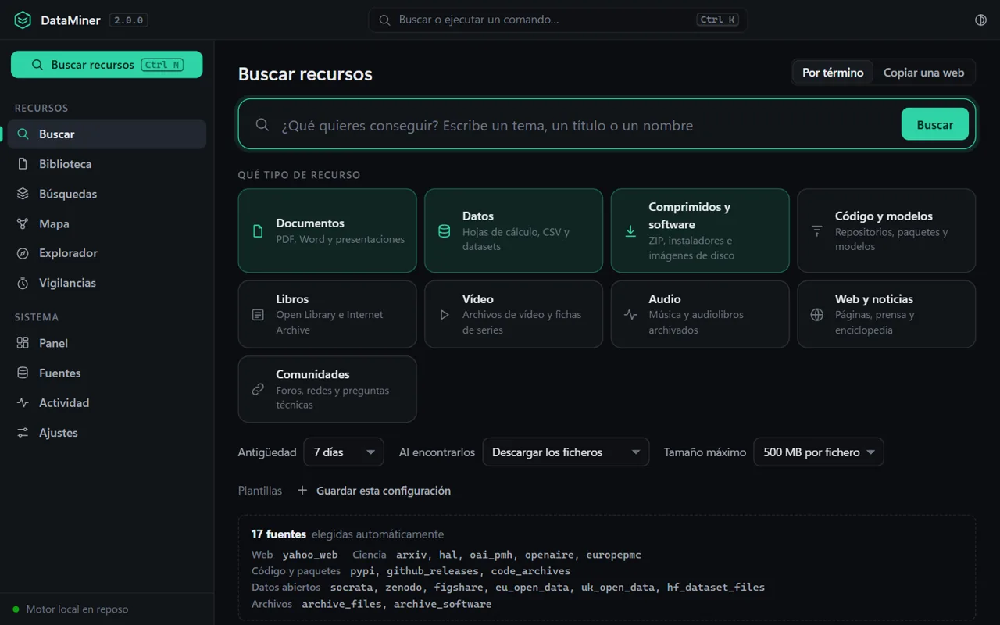

# 🕷 DataMiner: una araña por criterio de búsqueda



Le das un término y DataMiner lo busca a la vez en **20 fuentes** (buscadores web, prensa mundial, redes, foros, código, ciencia y archivos). Solo se queda con lo **reciente** (por defecto, los últimos 7 días). Después visita cada resultado, extrae el contenido limpio en Markdown, sigue los enlaces relevantes y descarga los ficheros enlazados (pdf, csv, xlsx…). Todo se guarda en `output/`.

## Descargar (Windows)

1. Ve a la página de [Releases](https://github.com/virtuanista/data-miner/releases/latest) y descarga `DataMiner-2.0.0-windows.zip`.
2. Descomprímelo en cualquier carpeta y abre **`DataMiner.exe`**. No necesita Python.
3. Tus búsquedas y descargas se guardan en `%USERPROFILE%\DataMiner\output\`.

Requisitos: Windows 10/11 con WebView2 (ya viene instalado en casi todos los equipos).

## Aplicación de escritorio (recomendado)

Haz doble clic en **`DataMiner.bat`**: se abre en su propia ventana sin bordes. Si prefieres el navegador, usa `dm web`. Si el puerto 8787 está ocupado por otra versión, usa el siguiente libre.

Secciones:

- **Buscar:** un campo y el tipo de recurso (Documentos, Datos, Comprimidos y software, Código, Libros, Vídeo, Audio, Web y noticias, Comunidades). Las fuentes y los `filetype:` se eligen solos según el tipo. «Afinar la búsqueda» despliega los operadores (frase exacta, `intitle:`, `site:` con paquetes como Google Docs y Drive, `inurl:`, exclusiones, directorios abiertos), los límites, las fuentes y la vista previa de las consultas. Las consultas se lanzan tal cual se ven, sin expansión oculta.
- **Biblioteca:** todos los ficheros descargados, de cualquier búsqueda, filtrables por tipo.
- **Mapa:** los hallazgos agrupados por tema, dominio o fuente y dibujados como gaussianas (WebGL aditivo, `static/map.js`). Tres niveles según el zoom: grupo, subgrupo y hallazgo. Clic para entrar y encuadrar, `Esc` para subir, flechas para recorrer grupos, `Inicio` para verlo todo. La agrupación por tema usa el término dominante de cada título (`hub.py`, `graph()`); no hay modelo semántico.
- **Respuesta** (pestaña de cada búsqueda): extractos literales de lo recolectado que mejor casan con la pregunta, con su fuente numerada. No es texto generado.
- **Plantillas** (en Buscar): guardan con nombre los tipos de recurso, operadores, sitios y límites.
- **Panel:** totales, actividad de los últimos 14 días, salud de las fuentes y dominios principales.
- **Recolecciones:** lista filtrable y, dentro de cada una, pestañas Resumen (embudo, descartes, fechas, dominios, parámetros), Recursos, Hallazgos, Páginas, Fuentes y Registro.
- **Explorador:** búsqueda en todo lo recolectado, entre recolecciones.
- **Vigilancias:** búsquedas guardadas que se repiten solas y separan lo nuevo. Solo se ejecutan con la aplicación abierta; el estado se guarda en `output/_platform/`.
- **Fuentes:** catálogo por categoría con el último estado y el aprovechamiento de cada una.
- **Actividad:** registro unificado de las últimas recolecciones.
- **Ajustes:** valores por defecto, tema, densidad, almacenamiento y sincronización (el servicio en la nube aún no existe).

Atajos: `Ctrl+K` paleta de comandos, `Ctrl+N` nueva recolección, `/` explorador, `Esc` cerrar.

La interfaz vive en `dataminer/static/` (`index.html`, `app.css`, `app.js`). La capa de plataforma está en `dataminer/hub.py` y la ventana en `dataminer/desktop.py`.

Funciones principales:

- **Nueva recolección (Ctrl+N)**, con dos modos:
  - *Por término*: con el alcance "Solo recursos descargables" o "Todo".
  - *Web completa*: descarga un dominio entero.
- **Recursos:** tabla filtrable por tipo (documentos, datos, comprimidos, software, código, imágenes, multimedia), fuente, texto y tamaño.
- **Vista previa lateral** de PDF, imágenes, audio, vídeo, CSV, JSON, código, contenido de ZIP y páginas. Muestra metadatos y SHA-256, con botones para descargar, mostrar en carpeta y abrir el origen.
- **Pestañas Hallazgos, Páginas, Fuentes y Actividad.** Puedes detener o reanudar una recolección y exportar CSV o el informe.
- **Seguridad:** lo descargado nunca se ejecuta ni se renderiza como HTML.

Fuentes de recursos: GitHub Releases, zips de repos, Zenodo, Figshare, OpenAIRE, data.europa.eu, data.gov.uk, Socrata, ficheros de Internet Archive y de Hugging Face, arXiv, además de búsqueda web con `filetype:`.

## Instalación desde el código

Requiere Python 3.11 o superior.

```bash
python -m venv .venv
.venv/Scripts/pip install -r requirements.txt
```

Para generar el ejecutable: `pip install pyinstaller` y después `pyinstaller DataMiner.spec --noconfirm`. El resultado queda en `dist/DataMiner/`.

## Uso

```bash
# PowerShell: .\dm.bat ...   ·   cmd: dm ...   ·   Git Bash: ./dm ...
dm search "copias de seguridad" -t backup -t "disaster recovery" --since 7d --depth 2
dm search "ransomware" --since 24h --langs es-ES,en-US --bg     # en segundo plano
dm status                                                       # progreso de la última ejecución
dm search "llm agents" --sources yahoo_web,hackernews,github,arxiv --site-pack dev
dm search "datos abiertos" --raw 'site:datos.gob.es "datos abiertos"' --filetypes csv,xlsx,json
dm search "x" --resume output/x_20261122-101500                # reanudar sin repetir trabajo
dm sources                                                      # lista de fuentes
```

| opción | efecto |
|---|---|
| `--since 90m / 24h / 7d / 2w / 1mo` | Ventana de frescura. Se aplica dos veces: en origen (filtros de fecha de cada API o buscador) y después sobre la fecha extraída. Lo antiguo se descarta, y las fechas parciales (solo año o año-mes) cuentan como «sin fecha». Lo que no trae fecha se conserva con la marca `dated:false`, salvo que uses `--drop-undated`. |
| `--depth 0` | Solo recoge los resultados de búsqueda (`results.jsonl`). |
| `--depth 1` | Además descarga cada resultado (hasta `--per-domain` páginas por dominio, 40 por defecto; los omitidos se cuentan en `summary.md`): texto limpio, autor, fecha, sitio y enlaces. Baja los ficheros relevantes que encuentre. |
| `--depth 2+` | Sigue los enlaces cuyo texto o URL contiene el término, por orden de relevancia. Respeta `--per-domain` y `--max-pages`. |
| `-t` | Añade sinónimos o traducciones. Cada término genera sus propias variantes de búsqueda. |
| `--raw`, `--site`, `--site-pack social/dev/video/docs/gov`, `--filetypes` | Operadores avanzados para los buscadores web. |
| `--concurrency`, `--per-host`, `--workers`, `--procs` | Paralelismo: red asíncrona HTTP/2 y extracción repartida en todas las CPUs. |
| `--no-files`, `--all-files`, `--max-file-mb` | Control de la descarga de ficheros. |
| `--bg` | Lanza un proceso desacoplado de la terminal. Consulta el avance con `dm status`. |

**Expansión automática de consultas.** Cada término genera estas variantes: `término`, `"término"`, `intitle:`, `término <año actual>`, `filetype:pdf/docx/xlsx/pptx/csv`, además de los `site:` que pidas y de búsquedas por idioma (`--langs`).

## Fuentes

| grupo | fuentes |
|---|---|
| Web | `yahoo_web` (índice de Bing, con operadores y filtro de frescura), `ddg_meta` (metabuscador ddgs: Google, Bing, Yandex, Mullvad…) |
| Noticias | `google_news`, `bing_news`, `gdelt` (prensa mundial en 65 idiomas, actualizada cada 15 min) |
| Social y foros | `hackernews` (historias y comentarios), `mastodon` (8 instancias), `bluesky`, `stackexchange` (11 sitios), `youtube`, `devto` |
| Código, modelos y paquetes | `github` (repos e issues; usa `GITHUB_TOKEN` si existe, para ir 3 veces más rápido), `gitlab`, `huggingface`, `npm` |
| Conocimiento y ciencia | `wikipedia`, `arxiv`, `openalex`, `crossref`, `internet_archive` |
| Libros, vídeo y audio (`media.py`) | `gutenberg`, `openlibrary`, `archive_books`, `archive_video`, `archive_audio`, `archive_software`, `commons_media`, `tvmaze` (fichas de series, sin vídeo) |

Con `--since 100y` («Sin límite» en la interfaz) los catálogos de Internet Archive se ordenan por popularidad en vez de por fecha de subida. Los ficheros por encima de `--max-file-mb` no se descargan: quedan como enlace directo en el hallazgo.

El operador `filetype:` del buscador web (Yahoo, índice de Bing) funciona bien con pdf, docx, pptx y xlsx; con zip es parcial y con epub, mp4 o json no devuelve nada, así que esos tipos se obtienen de los catálogos. No hay acceso a Google sin clave.

Los enlaces que aparecen dentro de posts de Mastodon, Bluesky o HN también se rastrean.

## Salida: `output/<término>_<fecha>/`

| fichero | contenido |
|---|---|
| `results.jsonl` / `results.csv` | Todos los resultados únicos (URL canónica sin tracking): título, snippet, fecha, fuente, consulta y metadatos de la fuente. Se escribe en vivo. |
| `pages.jsonl` / `pages.csv` | Una fila por página extraída: título, autor, fecha, sitio, relevancia, profundidad, de dónde vino, enlaces a documentos y feeds. |
| `pages/<dominio>/*.md` | El texto de cada página en Markdown, con *front-matter*. |
| `files/<dominio>/*` | Ficheros descargados. Los PDF también se convierten a `.md`. |
| `files.jsonl` | Inventario de ficheros: sha256, tamaño y tipo. |
| `summary.md` | Resumen: rendimiento por fuente, dominios principales, lo más reciente y lo más relevante. |
| `stats.json`, `run.log`, `query.json` | Progreso en vivo, log y parámetros de la ejecución. |

## Precisión

Las fuentes de búsqueda laxa (Crossref, OpenAlex, npm, GitLab, issues de GitHub, Stack Exchange, Internet Archive, Hugging Face, ddgs) solo aceptan resultados que mencionen el término en el título, el snippet o la URL. En términos compuestos cuenta la frase exacta, o bien todas sus palabras juntas. En el rastreo, una página a la que se llega por un enlace se guarda solo si menciona el término. Con `--keep-all` se desactivan estos filtros.

## Robustez

- Concurrencia global y por host, con un ritmo específico para cada API pública.
- Reintentos con *backoff* que se adapta a los 429.
- Cada fuente está aislada: si una falla o la bloquean, el resto sigue. Su estado queda en `summary.md`.
- Se respeta `robots.txt` durante el rastreo.
- Deduplicación por URL canónica y por hash de contenido.
- Escritura incremental y reanudación con `--resume`.
- Nombres de fichero seguros en Windows y UTF-8 en todas partes.

Cuando una fuente bloquea el acceso (captcha o 403), DataMiner la marca como degradada y continúa. **No** intenta saltarse captchas ni protecciones.

<p align="center">
	Repositorio generado por <a href="https://github.com/virtuanista" target="_blank">virtu 🎣</a>
</p>

<p align="center">
	
</p>

<p align="center">
	Copyright &copy; 2026
</p>

<p align="center">
	<a href="LICENSE"></a>
</p>
